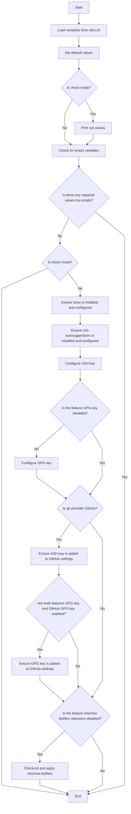

# ansidev's dotbs

## Introduction

I created this project for migrating my configurations among my devices.

At this moment, this project is built for macOS only.

## Installation

1. Download `bootstrap.sh` manually.
2. Download `vars.sh.example` manually and rename it to `vars.sh`.
3. Update `vars.sh`.
4. Check your variables.

   ```sh
   sh bootstrap.sh --check
   ```

   If the result is OK, go to the next step. Otherwise, go to the previous step.

5. Run

   ```sh
   sh bootstrap.sh
   ```

6. Restart your shell after the script is ran successfully.

## Flowchart



## zx-import Function

The `zx-import` function recursively adds directories to zoxide for fast navigation.

### Usage

```bash
# Add all directories recursively
zx-import /path/to/project

# Add only the root directory
zx-import --depth 0 /path/to/project

# Add root and immediate children (depth 1)
zx-import --depth 1 /path/to/project

# Add directories up to depth 2
zx-import --depth 2 /path/to/project

# Preview what would be added without actually adding
zx-import --dry-run /path/to/project
zx-import --dry-run --depth 1 /path/to/project
```

### Depth Parameter

The `--depth N` parameter controls how deep to recurse into the directory tree:
- `--depth 0`: Only the root directory itself
- `--depth 1`: Root directory + immediate children
- `--depth N`: Root directory + directories up to N levels deep
- Omit `--depth`: Add all directories (no depth limit)

Tool-generated directories (node_modules, .git, dist, build, vendor, etc.) are always excluded regardless of depth.

## Author

Le Minh Tri [@ansidev](https://ansidev.xyz/about).

## License

This source code is released under the [MIT License](/LICENSE).
